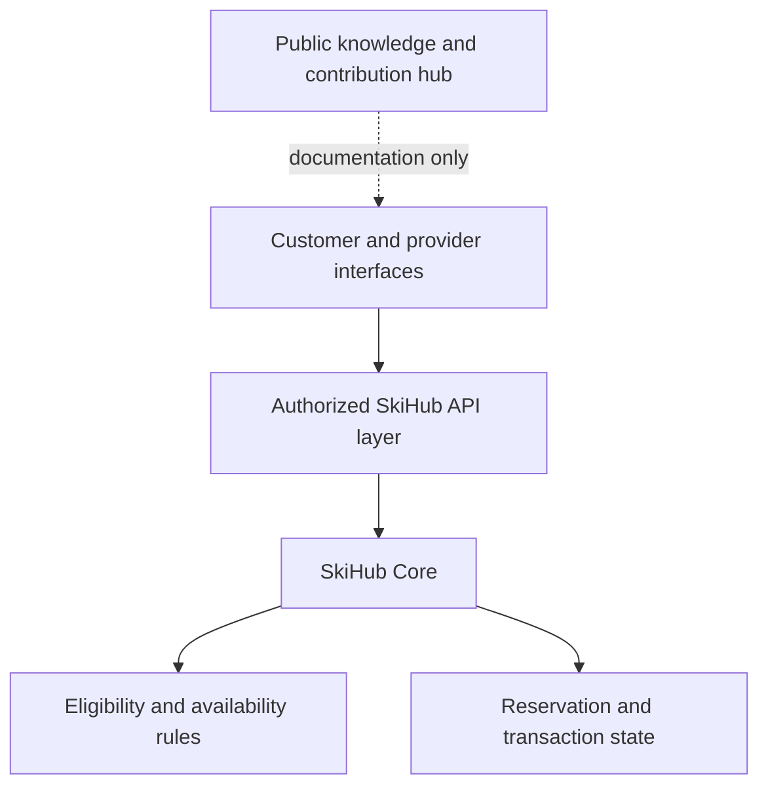

# Public architecture

This is a conceptual boundary diagram for the intended product. It is not a deployment map, verified integration topology, or source-code inventory.

## Components and responsibility

| Component | Responsibility | Boundary |
| --- | --- | --- |
| Customer and provider interfaces | Explain offers and collect validated requests | A visible button or form does not prove backend acceptance. Brand connections require verification. |
| Authorized SkiHub API layer | Authenticate callers, authorize actions, validate requests, and expose scoped contracts | Frontends do not receive database credentials or privileged service secrets. |
| SkiHub Core | Own identities, eligibility, availability, reservations, payments, rentals, and reviews | No parallel authoritative databases or replacement user identities. |
| Eligibility and availability rules | Apply identity/document, resort, and current-availability filters | Commercial ranking cannot override safety or eligibility. |
| Reservation and transaction state | Keep a consistent state with idempotency and auditable payment evidence | A mock response or UI success message is not a confirmed transaction. |
| This hub | Provide shareable product context and contribution instructions | No automatic source mirror, operational access, or deployment authority. |

## Development boundaries

Invited developers receive only the approved scope through a separately authorized private environment. Public contributors work on public documentation unless a different package and its terms have been approved. Repository access determines what a person can read; folders and branch protections do not create separate visibility zones.

Work that depends on sign-in, sessions, authorization, payment, or reservation integrity requires the relevant backend and a controlled test environment. A synthetic fixture may help test a state or validation rule. It cannot establish successful provider integration or live acceptance.

## Change boundaries

Changes begin with the existing contracts and user identities. Keep frontend, backend, data access, business rules, and integrations separate within the established stack. Prefer small changes and the current toolchain before adding dependencies or infrastructure.

A hub PR is not a product-source PR. An authorized maintainer must review any approved product change in its appropriate environment, verify the relevant tests, and use the separate product release process. No hub workflow may receive production secrets, production-network access, or permission to write product source.

See [CONTRIBUTING.md](../CONTRIBUTING.md) for the review route and [SECURITY.md](../SECURITY.md) for confidential reports.
